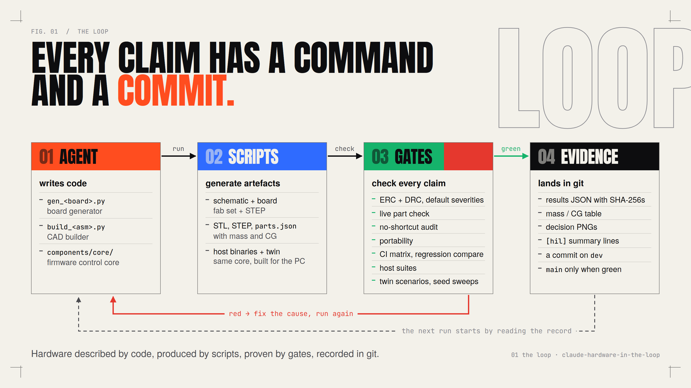
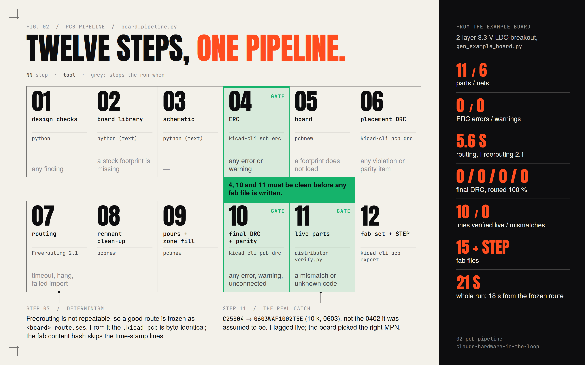
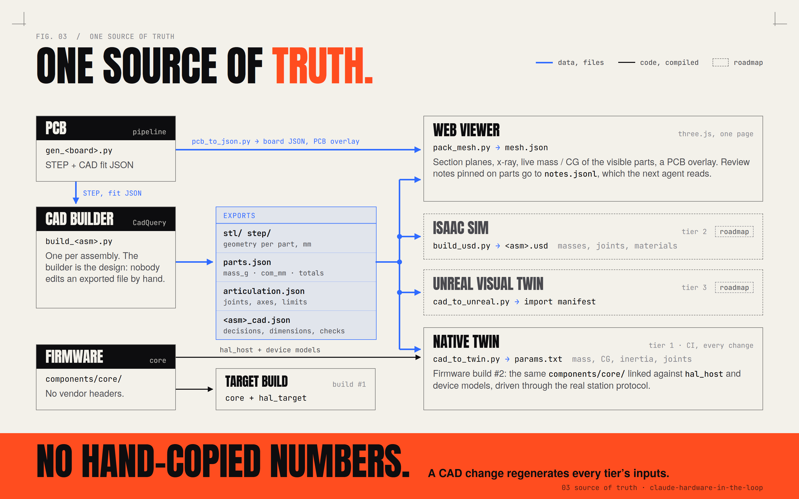
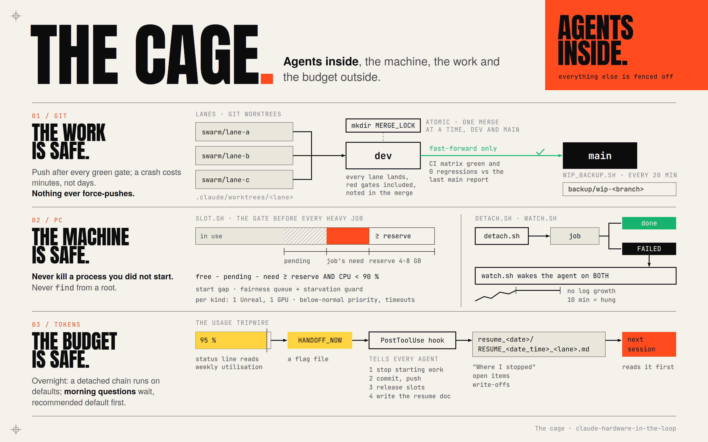
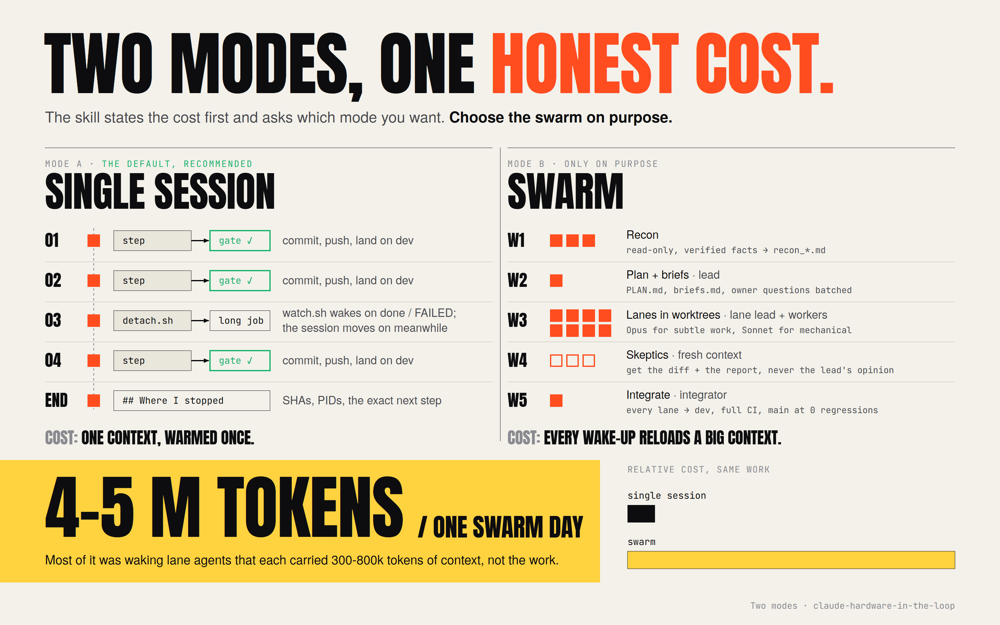

<p align="center">
  
</p>

<h1 align="center">claude-hardware-in-the-loop</h1>

<p align="center">
  <b>AI agents build real hardware. Gates prove it.</b><br>
  A method, a Claude Code skill and a tested project skeleton for letting agents design PCBs, CAD and firmware
  without losing work, wrecking the PC, or burning the budget silently.
</p>

<p align="center">
  <a href="#quick-start">Quick start</a> &nbsp;·&nbsp;
  <a href="#how-it-works">How it works</a> &nbsp;·&nbsp;
  <a href="#what-you-can-do-with-it">What you can do with it</a> &nbsp;·&nbsp;
  <a href="docs/METHOD.md">The method</a> &nbsp;·&nbsp;
  <a href="docs/LESSONS.md">38 lessons</a> &nbsp;·&nbsp;
  <a href="#licence">Licence</a>
</p>

<p align="center">
  
  
  
  
  
</p>

---

## What this is

Hardware described by code. Boards are Python scripts that one shared pipeline turns into a KiCad schematic, a routed
board, a fab set and a STEP model. Enclosures and assemblies are CadQuery builders that export geometry with mass and
centre of gravity. Firmware keeps its control core free of vendor headers, so the same code that runs on the target
runs on the PC against a digital twin.

Every claim is checked by a gate that runs on the machine: ERC and DRC at KiCad's default severities, a live
distributor check of every purchased part, a no-shortcut audit that fails on stubs and admitted guesses, a CI matrix
with regression compare, host test suites, twin scenarios over seed sweeps. Agents do the engineering inside that cage.
`main` moves only when the whole matrix is green.

<picture>
  <source media="(prefers-color-scheme: dark)" srcset="media/out/01-loop-dark.png">
  
</picture>

It comes from a private multi-board hardware project where agents designed the PCBs, the CAD and the firmware under
these gates for weeks. Everything project-specific has been removed. What is left is the method, the scripts, and the
templates, all of them run and tested on the way out.

## Why it is not a gimmick

Agents that "design a PCB" usually produce a picture of a schematic. This produces files you can order from, and it
refuses to produce them when anything is wrong.

- **A board that passes is a board you can order.** The pipeline writes fab files only when ERC is 0 / 0, the final DRC
  is 0 violations / 0 unconnected / 0 parity items at KiCad's default severities, and every purchased line resolves
  live to the MPN the schematic names. The example board runs all twelve steps in 21 seconds.
- **The checks caught real mistakes.** A distributor code that looked right resolved to an 0603 part instead of the
  0402 it was assumed to be; the live check failed the build and the board got the right part. Thirty-eight such
  lessons, each one an afternoon, are in [docs/LESSONS.md](docs/LESSONS.md).
- **Nothing is hand-copied.** Mass, CG, inertia and joints flow from the CAD export into the twin, the simulators and
  the viewer. A CAD change regenerates every tier's inputs.
- **Agents cannot lower the bar.** DRC severities are never demoted; a relaxed rule needs a cited basis; a test that
  exits 0 without its summary line is a failure; an empty suite is a failure; the audit fails on new stubs, canned
  success and admitted guesses.
- **The cost is stated up front.** One swarm day burned 4-5 million tokens. The skill says so before it does anything
  and recommends the cheaper mode. See [Two modes, one honest cost](#two-modes-one-honest-cost).

## What you can do with it

<picture>
  <source media="(prefers-color-scheme: dark)" srcset="media/out/06-what-you-can-build-dark.png">
  
</picture>

Anything you can describe in code and prove with a gate. In practice:

| You want | The method gives you |
|---|---|
| A board, from a breakout to a dense multi-layer | a generator, the shared pipeline, Freerouting, ERC / DRC gates, live part verification, a JLCPCB fab set, STEP and a fit JSON for the CAD |
| An enclosure or an assembly | a CadQuery builder with plug-in parts, interference and keep-out checks, a mass / CG table on every change, decision renders with clashes in red |
| Firmware you can trust before the board exists | out-of-tree builds, host suites with thousands of checks, a native twin that runs the real control code through the real station protocol, seed sweeps, determinism hashes |
| A system of several boards and parts | one pipeline for every board, one source of truth for every tier, a bench register for the constants only a bench can settle |
| Agents working while you sleep | detached night chains with a slot and a timeout per step, watchers that wake the agent on failure, morning questions with the default already taken |
| A way to look at the result | a three.js viewer with section planes, x-ray, live mass / CG, PCB and harness overlays, and review notes the next agent reads |

## How it works

### Boards: a board is a Python script

The script declares data: parts with their datasheet pin tables, nets, outline, holes, placement, net classes, pours.
One pipeline does the rest and stops at the first thing that is wrong. Nobody edits a `.kicad_pcb` by hand; the
generator is the design, and a fix to the pipeline fixes every board.

<picture>
  <source media="(prefers-color-scheme: dark)" srcset="media/out/02-pcb-pipeline-dark.png">
  
</picture>

Same inputs, same files: hashed string order, uuid5 schematic UUIDs, seeded board KIIDs, and a frozen route (the
router itself is not repeatable) give a byte-identical `.kicad_pcb` across runs. Details, flags and the hard lessons
are in [docs/PCB.md](docs/PCB.md).

### CAD, firmware and simulation: one source of truth

A CadQuery builder exports STEP, STL and a `parts.json` with mass and CG per part. The native twin, the Isaac Sim and
Unreal tiers and the web viewer all read those exports; the PCB pipeline's STEP and fit JSON flow back into the
builder. Firmware's control core is compiled twice from the same sources: once for the target, once for the twin.

<picture>
  <source media="(prefers-color-scheme: dark)" srcset="media/out/03-source-of-truth-dark.png">
  
</picture>

[docs/CAD.md](docs/CAD.md) has the builder and plug-in contract, [docs/FIRMWARE.md](docs/FIRMWARE.md) the host suites
and the twin rules, [docs/SIM.md](docs/SIM.md) the three tiers and the prompts to build the two that are roadmap.

### The cage: agents inside, everything else outside

Agents work in git worktrees and land every lane on `dev`, red gates included, so nothing is lost and conflicts show
up the same day. `main` is promoted only when the CI report for that exact commit is green with zero regressions.
Heavy jobs take a slot that gates RAM and CPU; long chains run detached with a watcher that wakes the agent on success
and on failure. Uncommitted work is snapshotted every twenty minutes. A usage tripwire makes every agent stop, push,
and write a resume document before the limit cuts it off.

<picture>
  <source media="(prefers-color-scheme: dark)" srcset="media/out/04-cage-dark.png">
  
</picture>

The whole method on one page: [docs/METHOD.md](docs/METHOD.md).

### Two modes, one honest cost

> Running this method as a **swarm** (a lead agent plus parallel lane agents) is expensive. On the project it comes
> from, **one swarm day burned 4-5 million tokens**, and most of that was not the work: it was waking lane agents that
> each carried **300-800k tokens of context** to read a message or check a log. The default is now a **single session
> with no subagents** that works step by step, runs long machine jobs detached, and resumes from a "Where I stopped"
> section. The skill offers both modes and recommends the single session. Choose the swarm on purpose.

<picture>
  <source media="(prefers-color-scheme: dark)" srcset="media/out/05-modes-dark.png">
  
</picture>

Roles, waves, briefs, skeptics and the integrator are in [docs/SWARM.md](docs/SWARM.md).

## Quick start

1. Install the skill (Claude Code reads skills from a project's `.claude/skills/` or your user skills folder):

   ```
   git clone https://github.com/Kemerd/claude-hardware-in-the-loop
   # per project:
   mkdir -p <your-repo>/.claude/skills && cp -r claude-hardware-in-the-loop/skills/hardware-in-the-loop <your-repo>/.claude/skills/
   # or for every project: copy the same folder into the skills folder of your Claude Code user config
   ```

2. In your project, ask Claude Code: *"set up a hardware project with the hardware-in-the-loop method"*. The skill
   states the token cost, asks which mode you want, runs the onboarding interview (goals, budget, quantities, printed
   material, fastening, enclosure sealing, fab vendor, MCU, simulation tiers and GPU, machine limits), then writes the
   skeleton with `scripts/scaffold.py`, sets up `main` and `dev`, and verifies or installs the tools.

3. Or do it by hand:

   ```
   python -I skills/hardware-in-the-loop/scripts/scaffold.py --answers answers.json --dest <your-repo> --with-examples
   pwsh -File skills/hardware-in-the-loop/scripts/setup_tools.ps1 -ToolsRoot D:\hiltools -VerifyOnly
   cd <your-repo> && pwsh -File windows/ci.ps1
   ```

   The answers format is in `skills/hardware-in-the-loop/references/interview.md`. Tools, pinned versions and hashes
   are in [docs/TOOLS.md](docs/TOOLS.md).

## What is in here

```
README.md, LICENSE, NOTICE
docs/
  METHOD.md      the whole method: storage tiers, branching (dev / main), gates, machine safety, handoffs, overnight
  PCB.md         generator-first boards: the 12 pipeline steps, determinism, Freerouting, hard lessons, protection rules
  CAD.md         CadQuery builders, the plug-in contract, mass / CG tables, decision images, material decisions
  FIRMWARE.md    out-of-tree builds, host test suites, firmware in the loop against a native twin, bench rigs
  SIM.md         native twin, Isaac Sim, Unreal: design, file layouts, the prompts to build them (roadmap)
  SWARM.md       lead / subagent models, waves, briefs, skeptics, integrator, locks, handoffs, single-session mode
  TOOLS.md       what to install, pinned versions and hashes, where it lives, home-directory isolation
  LESSONS.md     38 lessons: one sentence of symptom, one of rule
skills/hardware-in-the-loop/
  SKILL.md       the skill: cost warning, mode choice, interview, scaffold, tools, branches, harness, both modes
  references/    interview + answers.json schema, plan templates (swarm and single session), brief, structured
                 report, resume document, overnight chain + morning questions, wave checklist, agent-rules guide
  scripts/       scaffold.py (writes the skeleton), setup_tools.ps1 / setup_tools.sh (pinned toolchain)
  templates/     the project skeleton (see below)
viewer/          three.js CAD viewer: packer, local server with review notes, PCB-to-JSON exporter
media/out/       the README graphics and the explainer video
```

<details>
<summary><b>The project skeleton</b> (<code>skills/hardware-in-the-loop/templates/</code>), file by file</summary>
<br>

| Path | What it is | State |
|---|---|---|
| `README.md`, `README_AGENT.md`, `PROJECT_STRUCTURE.md`, `REQUIREMENTS.md`, `CODING_RULES.md` | root documents, filled from the interview | ready |
| `gitignore.template`, `gitattributes.template` | become `.gitignore` / `.gitattributes` (scratch, harness, KiCad per-user files, fab files as binary) | ready |
| `windows/ci.ps1`, `windows/ci/ci_common.psm1`, `windows/ci/audit.ps1`, `windows/ci/pcb.ps1` | CI matrix: group registry, parallel pwsh processes, `ci_report.json`, `-Compare -FailOn regressions`; groups `audit` and `pcb` | implemented, tested |
| `tools/audit_placeholders.py` + baseline / waivers JSON | no-shortcut audit: open-work markers, admitted guesses, Python stubs, hardware functions returning canned success, CAD stand-in names and bare primitives, default credentials; tracked baseline, signed waivers, `--changed-since` | implemented, tested |
| `tools/check_portability.py` | interpreter line, UTF-8 console, path anchoring, no user-profile paths | implemented, tested |
| `pcb/tools/kicad_env.py`, `board_pipeline.py`, `distributor_verify.py` | generator-first KiCad 10 pipeline: schematic from data, own footprint library, ERC, placement DRC, Freerouting, clean-up, pours, final DRC with parity, JLCPCB fab set, live LCSC verification, STEP, fit JSON, results JSON with SHA-256s | implemented, tested end to end |
| `pcb/example_board/gen_example_board.py` | a real 2-layer 3.3 V LDO breakout (TVS, PTC with sense line, redundant power / ground pins) | runs green in about 20 s |
| `pcb/DESIGN_STANDARDS.md` | rule book skeleton with rule ids and a project decision table | ready (a machine checker for the rule ids is roadmap) |
| `cad/cad_plugins.py`, `cad/render.py`, `cad/mass_cg_table.py` | plug-in loader, decision renders (clash in red, dimensions), weight-and-balance table | implemented, tested |
| `cad/examples/enclosure/` | sealed enclosure builder + gasket and gland-access plug-ins | runs, checks pass |
| `firmware/host_tests/hil_check.h` | header-only check library with a parseable summary line, plus its self-test | implemented, tested (C99 and C++11) |
| `harness/swarm/locks/slot.sh` | machine gate: RAM reserve, CPU cap, start gap, fairness queue, starvation guard, per-kind capacity, stale reclaim | implemented, tested |
| `harness/swarm/detach.sh`, `watch.sh` | detached chains with done / FAILED markers; watcher for success, failure, hang, crash | implemented, tested |
| `harness/swarm/merge_lock.sh`, `merge_to_dev.sh`, `promote_dev.sh`, `wip_backup.sh` | dev / main model: every lane lands on dev, promotion only when green with 0 regressions; WIP snapshots without force-push | implemented, tested on a local remote |
| `harness/swarm/usage_statusline.py`, `handoff_hook.sh`, `handoff_hook.json` | usage tripwire and the stop-and-write-a-resume-document hook | implemented, tested |
| `harness/swarm/AGENT_RULES.md`, `claude/settings.local.json.example` | binding rules for agents; hook and status-line wiring | ready |
| `docs/bench/BENCH_REGISTER.md`, `docs/data/README.md` | bench parameter register, tracked results index | ready |

</details>

### The viewer (`viewer/`)

`pack_mesh.py` packs a builder export into a compact payload, `serve.py` serves it locally with a review-notes API
(notes pinned on parts land in a JSONL file the next agent reads), `index.html` is a single-page three.js viewer:
section planes, x-ray, parts list by mass, a live mass / CG panel of the visible parts with a CG marker, a materials
panel, a PCB overlay from `pcb_to_json.py` (outline, courtyards per side, mounting holes), and a harness overlay (wire
runs as tubes with zip-tie points and run lengths). See [viewer/README.md](viewer/README.md).

## Implemented vs roadmap

Nothing here is sold as done that is not. The right column is designed and written up, not built.

| Area | Implemented | Roadmap |
|---|---|---|
| Gates | CI matrix, audit, portability, ERC / DRC re-check, regression compare | a standards checker that implements the DESIGN_STANDARDS rule ids |
| PCB | full generator pipeline with Freerouting, live part verification, fab set, STEP | in-house completion router for fine-pitch escapes, BGA fan-out helpers, panelization |
| CAD | plug-in contract, renders, mass / CG tables, example builder | interference check with exact contact areas, STEP-based catalogue part import |
| Firmware | host check library, the twin pattern and its rules | a twin template project (physics + device models + station protocol) |
| Simulation | native twin design | Isaac Sim and Unreal tiers (design, layouts and prompts in SIM.md) |
| Viewer | parts, sections, notes, mass / CG, materials, PCB and harness overlays | copper layers, harness clearance and bend-radius checks, measurements, exploded view, build-to-build diff |
| Orchestration | slots, detached jobs, watchers, merge lock, dev / main, WIP backup, usage tripwire, templates for plans, briefs, reports, resume documents, overnight chains | |

## Licence

Source-available under the Hardware-in-the-Loop Attribution and Share-Alike Tooling License 1.0 (HIL-ASA-1.0), see
[LICENSE](LICENSE). It is **not** an OSI-approved open-source licence: it adds a restriction on selling the tooling
itself. Use it, commercially too, to design, build and sell your own boards, firmware and products on any terms you
like; all you owe is credit. Fork it, change it and share it for free, as long as the notice and the licence stay
intact. Selling the tooling itself, bundling it into a paid product, or running it as a paid service is allowed only if
that product's full source is published under HIL-ASA-1.0. The credit line to use (also in [NOTICE](NOTICE)):

```
Based on claude-hardware-in-the-loop by Kemerd (https://github.com/Kemerd/claude-hardware-in-the-loop)
```
